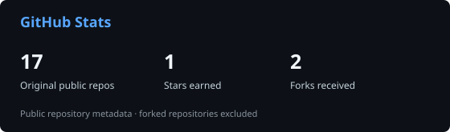

## About Me

I'm a Computer Science undergraduate at Universidade de Fortaleza, working with data, automation and artificial intelligence, with a background in software development.

I build Python data pipelines, Power BI dashboards and AI agents, turning business requirements into reliable solutions. My work includes data extraction, integration and validation, HTTP-based automation, parallel processing and document analysis with OCR and Microsoft Copilot. I also have experience with statistics and machine learning projects.

I'm an AWS Certified AI Practitioner with advanced English proficiency. I'm interested in data engineering, applied machine learning and building complete systems that connect data, software and business needs.

## What I Do

- Build data pipelines and system integrations with Python, SQL, pandas and HTTP requests, with validation, logging and checkpoints
- Develop Power BI dashboards with DAX, Power Query and dimensional modeling to support business decisions
- Create AI agents and document-processing workflows using OCR, structured responses and human review
- Apply statistics and machine learning to analytical projects, including revenue and sales forecasting
- Build REST APIs and web/mobile applications with Java (Spring Boot), FastAPI, React, React Native, TypeScript and Docker

## Tech Stack

### Languages

### Data, Machine Learning & Automation

### Backend & APIs

### Frontend & Mobile

### Databases & Infrastructure

### Dev Tools

## Selected Projects

- **[Road Safety Analytics Ceará](https://github.com/felipexxxxx/road-safety-analytics-ceara)** — Power BI analysis of 5,513 road incidents, with data validation, a star schema and DAX measures.
- **AllSet — [Backend](https://github.com/leonardodesaboia/TCC-back) · [Mobile App](https://github.com/leonardodesaboia/TCC-front)** — A team-built capstone project connecting clients and independent service providers, using React Native, Java (Spring Boot), PostgreSQL and Redis.
- **Professional AI and automation work** — Python pipelines with HTTP requests and controlled concurrency, document processing and Copilot agents based on corporate review guidelines. Internal projects; source code is not publicly available.

## GitHub Stats

  
  

## Get in Touch

Feel free to explore my repositories and reach out if you'd like to collaborate or discuss technology.

  
  
  

