## About Me

I'm a Computer Science undergraduate at Universidade de Fortaleza working across data engineering, data science, and automation, with a background in software development.

I use Python and SQL to extract, integrate, and validate data, and Power BI to build dashboards for operational metrics. I've applied statistical and machine learning methods to revenue and sales forecasting. I also build AI agents that invoke language models programmatically, combining OCR and structured response validation for document analysis.

I hold the AWS Certified AI Practitioner and AWS Certified Cloud Practitioner credentials. I'm interested in building systems that connect data, software, and business needs.

## Tech Stack

### Data Science, Analytics & Automation

### Software Development

### Databases & Data Infrastructure

## Most Used Languages

  

## Get in Touch

Feel free to explore my repositories and reach out if you'd like to collaborate or discuss technology.

  
  
  

